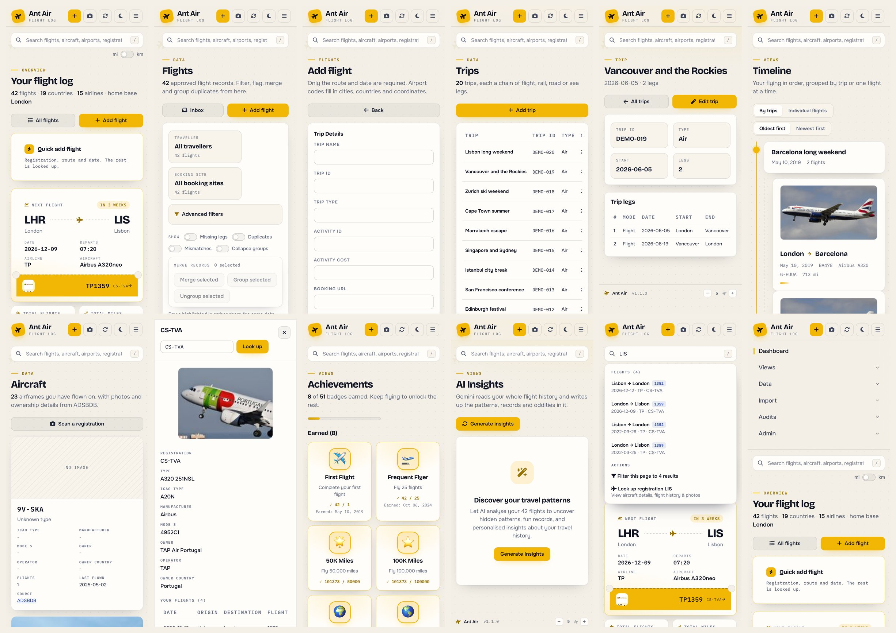
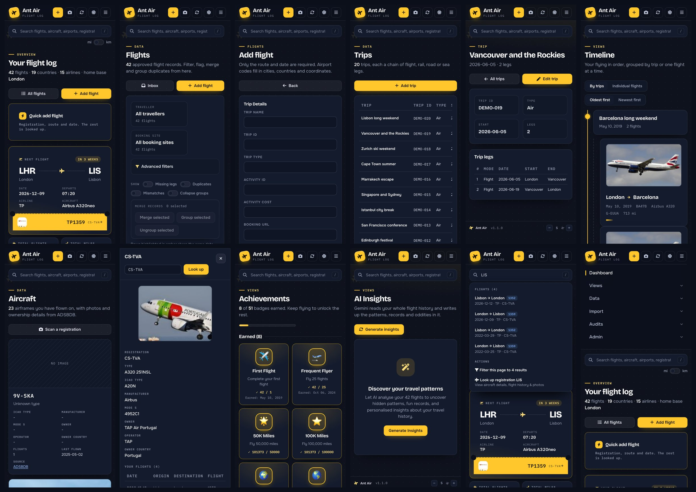

# The mobile app (iOS and Android)

Status: proposal, November 2026. Nothing here is built yet.

`mobile/` will be Ant Air's app for iPhone and Android: **React Native with Expo, native views, no web view**. It looks like the web app, works fully offline, and signs in either to the hosted edition or to a self-hosted server ([hosted.md](hosted.md) describes the two editions). It replaces the SwiftUI app in `ios/` and supersedes the client half of [PLAN-iOS.md](../PLAN-iOS.md). The backend half of that plan (REST API, revision-based sync) is built and is reused.

## Contents

1. [Goals](#1-goals)
2. [Where we are today](#2-where-we-are-today)
3. [How it looks](#3-how-it-looks)
4. [Stack](#4-stack)
5. [Navigation](#5-navigation)
6. [Signing in, and the session](#6-signing-in-and-the-session)
7. [Screens](#7-screens)
8. [Offline mode](#8-offline-mode)
9. [Design system implementation](#9-design-system-implementation)
10. [Phased delivery](#10-phased-delivery)
11. [Testing](#11-testing)
12. [Risks and open decisions](#12-risks-and-open-decisions)

---

## 1. Goals

- **Looks like the web app**, in both themes: the same palette, type, textures, ticket card, eyebrow labels and charts.
- **Rich and native**: gestures, bottom sheets, haptics, entrance animations, swipe actions, a full-screen map.
- **Fully usable offline.** Every read comes from the device. Every edit works in airplane mode and syncs later. Online-only extras (lookups, scans, AI) wait in a queue and finish themselves when the connection returns.
- **Hosted or self-hosted**: the app is built for the hosted edition and signs in with a passkey. "Use your own server" signs in to a self-hosted Ant Air through Cloudflare Access with a service token and an API key. Both logins can be kept on one phone.
- **One codebase for iOS and Android.** iOS first; Android gets a polish pass in Phase 4.

Not in the app: audits, CSV import, utility scripts and badge admin stay on the web. Account management, apart from what the App Store requires, also stays on the web.

## 2. Where we are today

| Piece | State | Fate |
|---|---|---|
| `ios/AntAir` (SwiftUI, SwiftData, ~7,100 lines) | Has login, two-way sync, dashboard, flights, map, aircraft, achievements, insights and settings. Still uses the **pre-redesign blue palette** (`Theme.swift`: `#2563EB` and friends) and system fonts, with seven tabs. Signs in with a username and password (`/api/v1/auth/token`). | Replaced once the new app reaches parity (Phase 5). Keep its tag for reference. |
| `/api/v1` (`app/api_v1.py`) | CRUD for flights, trips, legs, aircraft, achievements; `/stats/summary`; `/sync/status`, `/sync/changes`, `/sync/push` with field-level conflict merge | **Reused**, with the additions in [hosted.md 5](hosted.md#5-self-hosted-changes) and [8.8](#88-server-work-for-offline) |
| `design-tokens.json` | Mirrors the redesigned CSS variables | **Single source** for the app's theme, extended with the tokens it is missing |
| Domain logic | Server: `services/analytics.py`, `services/flight_groups.py`. Swift ports: `FlightReporting.swift`, `BadgeCalculator.swift`, `DashboardStats.swift`. | Ported to TypeScript and held to the server's numbers by golden tests ([8.6](#86-stats-and-badges-on-the-device)) |

For sizing, a long-standing personal log runs to about 660 flights, 47 countries and 45 airlines. The whole log fits on a phone with room to spare.

## 3. How it looks

**The app looks like the web app.** A screen is its web page at a phone's width, rebuilt from native views, with the same header, cards, pills, type and order of things. Where the web page is broken at phone width, that is the web's fault and is not copied ([3.2](#32-where-the-web-is-wrong-on-a-phone)).

The reference pictures are in [`mobile/reference/`](../mobile/reference/README.md): the web app at 390 × 844 in light and dark, on the demo log (`scripts/seed_demo_data.py`). **A screen in the app is judged against its picture there.**

| Light | Dark |
|---|---|
|  |  |

### 3.1 Signatures to reproduce exactly

Values come from `app/static/styles.css` and `design-tokens.json`.

| Element | Web | App |
|---|---|---|
| **Page background** | Cream `#f4f0e7` / night navy `#0b0f1a`; 1 px dot grid every 22 px (`--bg-dot`); a large brand-soft radial glow at the top right; a 3.5 % noise grain | `<Backdrop>`: an SVG dot pattern and radial gradient behind each screen, and a pre-rendered grain PNG. The dots scroll with the content. |
| **Panels** | `#fffdf9` / `#141b2d`, 14 px radius (20 px for hero panels), hairline border, two-layer soft shadow, inset top highlight | `<Panel>` |
| **Brand button** | Yellow `#f2b705` / `#ffc72c`, ink `#1c1500` text, Font Awesome icon, glow | `<Button variant="brand">`, with a press-in scale and a light haptic |
| **Ghost button** | 5 % ink tint, hairline border | `<Button variant="ghost">` |
| **Display type** | Bricolage Grotesque, weight 750, −0.025em: titles, IATA codes, big numbers | Bundled font. React Native letter spacing is in points, so em values are converted per size. |
| **Body type** | Onest 400–700 | Bundled |
| **Data and labels** | IBM Plex Mono: dates, registrations, flight numbers, and UPPERCASE 0.12em labels (`TOTAL FLIGHTS`, `DEPARTS`) | `<Mono>`, `<Label>` |
| **Eyebrow** | 20 px yellow dash and a mono uppercase kicker (`— OVERVIEW`, `— DATA`) above every title | `<PageHeader eyebrow title subtitle>` |
| **Next-flight ticket** | Boarding-pass card: IATA pair with a dotted route and plane glyph, a 2 × 2 grid of mono fields, a perforated yellow stub with half-circle notches (airline logo, flight number, registration), and an `IN 3 WEEKS` pill | `<TicketCard>`, notches drawn as an SVG path, with the plane gliding along the dotted line (the web's `flyAcross`). Also the header of Flight detail. |
| **Stat tile** | Mono label with icon, big display value, mono caption, optional thumbnail (aircraft photo, flag chips, airline logos) | `<StatTile>` |
| **Charts** | Chart.js: chart-1…8 palette, mono 11 px axes, 8 % gridlines, rounded bars with soft gradients, dark tooltip | Small SVG chart components (bars, line, donut, horizontal bars) |
| **Route map** | Leaflet on OSM: blue routes on light; darkened tiles and **yellow** routes on dark; a home-airport dot | MapLibre with the same colours ([8.2](#82-what-lives-on-the-device)) |
| **Badge card** | Yellow-tinted icon square with emoji, title, description, progress bar, mono `42 / 25` | `<BadgeCard>` |
| **Timeline** | Yellow rail with dots, trip cards, photo cards | `<TimelineRail>` |
| **Icons** | Font Awesome 6.5 Free, solid | `FontAwesome6` from `@expo/vector-icons` (the same glyphs) |
| **Motion** | `rise`, `fadeIn`, `modalIn`, `flyAcross` | Reanimated entrance animations with a stagger; Reduce Motion respected |

### 3.2 Where the web is wrong on a phone

At 390 px the web is the desktop page in one column: the dashboard is over 10,000 px tall, and several tables scroll sideways. These are the web's faults and are not copied:

| Web at phone width | App |
|---|---|
| Paginated ranking tables inside each dashboard card | The chart card with the top five and *See all*, which opens a full ranking screen |
| Wide tables (trips, flights, trip legs) cut off at the right | Cards and list rows |
| The 40-field flight form in one column | Essentials first, the rest in collapsible groups, with airport and airline pickers |
| Admin controls inline on the flights page (merge, group, Gemini fields, refresh) | Not carried over |
| The header's icon row (add, scan, refresh, theme, menu) | Add and scan stay in the Home header; refresh is pull-to-refresh; theme is in Settings; the menu is the tab bar |

**Recommended alongside the app:** fix the same things in the web's own phone layout. Hosted users will open the web on their phones too, and the app and the web then share one phone design.

## 4. Stack

Pin versions to the Expo SDK that is current when work starts, and to Expo's recommended version of each package.

| Concern | Choice |
|---|---|
| Framework | Expo, React Native New Architecture, TypeScript strict |
| Routing | Expo Router |
| Talking to the server | **openapi-fetch**, typed from `/api/v1/openapi.yaml` and generated into `src/api/schema.d.ts`. CI fails a pull request whose generated file is stale. A screen never calls `fetch` or builds an address. |
| Online-only reads | TanStack Query with a persister: insights, flight history, aircraft lookups, `/config` |
| **Local database** | **expo-sqlite + Drizzle ORM**: the synced log, the outbox, FTS5 search. The offline mode needs the whole log on the device ([8](#8-offline-mode)). |
| Secrets | expo-secure-store: credentials, servers, the login kept aside |
| Passkeys | react-native-passkeys, against the hosted `/auth/app/*` ceremonies |
| Purchases | expo-iap (StoreKit 2) for plans on iPhone |
| Map | @maplibre/maplibre-react-native |
| Graphics and charts | react-native-svg |
| Animation and gestures | react-native-reanimated, react-native-gesture-handler |
| Images | expo-image (disk cache, prefetch) |
| Fonts and icons | expo-font (bundled OFL fonts), `@expo/vector-icons` FontAwesome6 |
| Lists | @shopify/flash-list |
| Device | expo-camera / expo-image-picker, expo-haptics, @react-native-community/netinfo, expo-background-task |
| Builds | EAS Build and Submit, started from GitHub; EAS Update for JavaScript fixes |
| Tests | Jest (jest-expo) and React Native Testing Library; Maestro for end-to-end runs and screenshots |

### 4.1 Layout

Its own package: its own `package.json` and lockfile, none of it in the server image (`.dockerignore`), and a change that touches only `mobile/` does not redeploy the server.

```
mobile/
  app.json, eas.json
  reference/            the web on a phone: what each screen must look like (§3)
  assets/fonts/         Bricolage Grotesque, Onest, IBM Plex Mono, with their licence
  src/
    app/                Expo Router routes: _layout, welcome, signin, own-server,
                        (tabs)/{index, flights/…, map, explore/…, settings/…}, search, quick-add
    config.ts           API_ORIGIN (the hosted edition unless built otherwise), DEV_CREDENTIAL
    api/                client.ts, server.ts (which server, Access headers),
                        problem.ts, query.ts, schema.d.ts (generated)
    session/            store.ts, SessionProvider.tsx, logins.ts (two logins)
    theme/              tokens.ts (generated), ThemeProvider
    ui/                 Backdrop, Panel, PageHeader, Button, StatTile, TicketCard,
                        BadgeCard, Chip, SegmentedControl, TextField, PickerSheet,
                        KeyValue, ProgressBar, AirlineLogo, AircraftPhoto, FlagChip,
                        SyncPill, charts/
    db/                 Drizzle schema, migrations, queries, FTS (one database per login)
    sync/               engine, outbox, jobs
    domain/             TypeScript ports: reporting (group primary), stats, badges,
                        distance, continents, airline codes
    reference-data/     bundled airports, airlines, world map
    features/<name>/    dashboard, flights, trips, map, aircraft, timeline,
                        achievements, insights, search, account
  tools/                tokens and reference-data builders, side-by-side sheets
  maestro/              flows, including screenshot capture
```

Root scripts: `npm run mobile:api` (regenerate the client types), `npm run mobile:tokens` (regenerate the theme). Both take `-- --check` for CI.

## 5. Navigation

The web's menu is Dashboard · Views (Timeline, Achievements, AI Insights) · Data (Flights, Trips, Aircraft) · Import · Audits · Admin. The app has **five tabs**:

| Tab | Contents | Icon |
|---|---|---|
| **Home** | The dashboard | `house` |
| **Flights** | Segmented *Flights / Trips*; an Inbox chip with a count when draft flights exist | `plane` |
| **Map** | The full-screen route map | `earth-europe` |
| **Explore** | Timeline, Aircraft, Achievements, AI Insights, as large cards with live counts | `compass` |
| **Settings** | Sync, units, theme, storage, account and login, about | `gear` |

- **Home's header** matches the web: yellow logo tile, "Ant Air / FLIGHT LOG", a yellow **+** (Quick add sheet; long-press for the full form) and a **camera** button (scan a boarding pass or registration).
- **Search**: the field under Home's header, or the search icon on other tabs, opens a full-screen search.
- **Sheets** for aircraft lookup, filters, quick add and pickers.
- **Deep links**: `antair://flights/:id`, `/trips/:id`, `/aircraft/:reg`.

## 6. Signing in, and the session

### 6.1 The hosted edition (the default)

- `API_ORIGIN` in `src/config.ts` is the hosted origin, from `EXPO_PUBLIC_API_ORIGIN` at build time (a development build points it at a local hosted server). It is never a secret.
- **Welcome screen**: *Try it first* (a first name, then straight into a trial account pre-filled with the demo log; [hosted.md 6](hosted.md#6-the-phone-apps-way-in)), *Sign in* and *Create an account*, both with a passkey (`react-native-passkeys` against `/auth/app/*`). A finished ceremony returns an **app session** (`aa_app_…`), kept in the secure store.
- **First run on hosted**: home airports, traveller name and distance units, the same steps as the web's onboarding. A trial skips them until the passkey is made.
- A server 401 signs the session out. A network failure never does.

### 6.2 Your own server

For a self-hosted Ant Air. A quiet *Use your own server* link under the sign-in card opens a form with:

- the **address** (`https://` only; `http://` in a development build for a server on the same network);
- the **Cloudflare Access service token**: Client ID and Client Secret, both or neither (neither for a server with nothing in front of it);
- an **API key** (`aa_…`) issued on the server's Settings → API keys page.

Nothing is kept until `GET /api/v1/me`, sent with exactly what was typed, says who the key is. Every request to that server then carries `CF-Access-Client-Id` and `CF-Access-Client-Secret` beside `Authorization: Bearer <key>`.

When Cloudflare Access answers instead of the server (an HTML page, or a redirect to another host, on a JSON request), the app says so in words and **does not sign out**, so a revoked or wrong token can be fixed without losing anything. The server's own 401 does sign out. `src/api/server.ts` holds these rules (`readOrigin`, `accessHeadersFor`, `answeredByAccess`).

**Setting it up** (to document in the self-hosted README): a service token in Zero Trust → Access → Service credentials, added to a **Service Auth** policy on the Ant Air application; an API key issued on Settings → API keys.

Hosted-only screens (account, plan, sessions, delete account, trial) are not shown on your own server.

### 6.3 Two logins on one phone

At most two logins are kept: one hosted (an app session) and one own server (key, token, address). One is active; the other is kept aside in the secure store. Settings and the account sheet offer *Switch to <the other>*. The front door offers *Back to <it>* for a login kept aside.

**One local database per login** (`antair-hosted.db`, `antair-own-<host>.db`). Switching closes one and opens the other, so it is instant, nothing has to be re-downloaded, and **nothing pending is lost**: the outbox stays with its own log and is pushed the next time that login is active. Signing out deletes that login's database after confirming any unsent changes.

### 6.4 What the edition changes in the app

`GET /api/v1/config` (cached for offline use) tells the app:

- the **edition** (hosted screens or not);
- the **features**: `lookups` (FlightAware), `ai` (Gemini), each true only when the server has the key and, on hosted, the plan allows it. A feature that is off shows its explanation in the server's words, exactly as the web does, never an error;
- the account's **personal settings** (home airports, traveller, units default) for offline stats;
- the airline-logo URL template and the minimum app version.

**Plans on iPhone** are bought in the app through In-App Purchase (`expo-iap`), the server's half being [hosted.md 7](hosted.md#7-plans-and-billing). The Android app sells nothing until Play Billing is built.

## 7. Screens

Each lists its reference picture in `mobile/reference/`.

### 7.1 Home (`web-dashboard`)

1. **Hero**: eyebrow `OVERVIEW`, "Your flight log", the summary line (*42 flights · 19 countries · 15 airlines · home base London*), and the sync pill ([8.4](#84-connectivity)).
2. **Next flight `TicketCard`** with a live countdown pill; tap for Flight detail. Hidden when nothing is upcoming.
3. **Quick add card**, opening the Quick add sheet.
4. **Stat tiles**, two columns: total flights, total distance, top destination, top country (flags), busiest year, top airline (logos), top aircraft type (photo), top tail number (photo), first flight, last flight. Each opens the matching list.
5. **Filter chips** (traveller, booking site, year), opening a sheet.
6. **Chart cards**, each a chart and the top five, with *See all*: flights and distance by month, destination countries (donut), destination cities, airlines, aircraft types, aircraft-type distance, tail numbers, routes, flights by year, distance by year, CO₂ by year.
7. **Route map preview**, opening the Map tab.
8. **Recent flights**: five rows and *View all*.

### 7.2 Flights (`web-flights`)

- Sticky search, filter chips (traveller, year, airline, *Follow-up*, *Excluded*, *Duplicates*), then a list sectioned by year.
- **`FlightRow`**: IATA pair in display type, city names, mono date, flight-number chip, airline logo, aircraft and registration in mono. A yellow dot marks a change not yet synced; a stack icon marks a duplicate group.
- Duplicate groups are collapsed to their primary by default, by the same rule as `flight_groups.py`.
- **Swipe actions**: follow-up, exclude from stats, delete (with an undo toast).

### 7.3 Flight detail (new)

The web has edit and quick-edit, not a read-only page. A `TicketCard` header, then panels of mono label/value rows: *Schedule*, *Aircraft* (photo, type, registration; tap for the aircraft sheet), *Airline*, *Booking*, *Trip*, *Flight history* (fetched on demand and cached). Toolbar: Edit, Duplicate, Follow-up, Exclude, Delete.

### 7.4 Add and edit (`web-flight-new`)

- **Quick add sheet**: registration, from, to, date. Saved at once. The FlightAware lookup that fills in the rest runs on the server when online, or waits in the queue.
- **Full form**: *Essentials* always open; *Times and aircraft* and *Booking and trip* collapsible. Airport and airline pickers search the bundled data offline and fill city, country and coordinates as the web does. Distance is computed on the device.

### 7.5 Trips (`web-trips`, `web-trip`)

Trip cards (name, dates, legs, mode icons, trip code in mono). Detail: the web's tiles (trip ID, type, start, legs), then the legs as a vertical itinerary on the timeline rail. Create, edit and delete, offline.

### 7.6 Map (the dashboard's route map card)

Full screen. Arcs in accent blue on light and brand yellow on dark; home airport marked. Colour modes (single colour, by year, by airline) and the shared filter sheet. Tap an arc or an airport for its flights.

### 7.7 Explore

- **Timeline** (`web-timeline`): the yellow rail, *By trips / Individual flights*, *Oldest / Newest first*, photo cards, sticky years.
- **Aircraft** (`web-aircraft`, `web-aircraft-lookup`): a grid of airframes with cached photos; the detail sheet follows the web's registration lookup (photo, details, your flights, flight history). *Scan a registration* uses the camera.
- **Achievements** (`web-achievements`): "8 of 51 badges earned", earned and locked sections, badge cards and a detail sheet. Computed on the device, so a badge unlocks the moment a flight is added offline, with a haptic.
- **AI Insights** (`web-insights`): the last result from the cache; *Generate* needs a connection and the `ai` feature.

### 7.8 Search (`web-search`)

Full screen, over local FTS5: flights (route, cities, airports, flight number, airline, registration, traveller), trips and aircraft, grouped as on the web, with actions such as *Look up registration CS-TVA*.

### 7.9 Settings

The login (hosted account or own server, *Switch to…*), sync (last sync, revision, outbox items with status, *Sync now*), conflicts, units, theme (System / Light / Dark), storage (photo cache, map data, *Clear*), *Download photos on Wi-Fi only*, plan (hosted, iPhone), about, sign out.

## 8. Offline mode

### 8.1 Principles

1. **Local-first.** Screens read only from SQLite (`useLiveQuery`). The network never blocks a screen.
2. **Every write is local first**: the row and an outbox entry in one transaction, then the screen updates.
3. **Sync runs in the background**: push the outbox, then pull. The user sees a pill, not a modal.
4. **Online-only work is a job, not an error**: lookups, scans and AI generation are queued, with a visible state.

### 8.2 What lives on the device

| Data | Source | Size |
|---|---|---|
| Flights (all statuses, drafts and deletions included), trips, legs, aircraft, badges | `/api/v1/sync/changes` | 2–4 MB for about 660 flights |
| Config and personal settings | `/api/v1/config` | < 1 KB |
| Airports and airlines | Built from `app/static/airports.dat` and `airlines.dat` | ~1 MB |
| Country → continent, country → flag | Ported from `map_country_to_continent` | < 50 KB |
| World map | Natural Earth 1:50m as bundled vector tiles, with Ant Air light and dark MapLibre styles | 3–6 MB |
| Fonts | Bricolage Grotesque, Onest, IBM Plex Mono (OFL) | ~1 MB |
| AI insights, flight history | TanStack Query cache, persisted | Small |
| Aircraft photos, airline logos | expo-image disk cache: logos for every airline in the log are prefetched, photos on Wi-Fi; 200 MB cap | Varies |

**Map tiles.** OpenStreetMap's tile policy forbids bulk downloads for offline use, so the offline map is the bundled vector world in Ant Air's colours. Online, it can add a detail layer from the server's configured tile provider ([hosted.md 1.1](hosted.md#11-configuration-appconfigpy)).

### 8.3 What works offline

| Feature | Offline | When the connection returns |
|---|---|---|
| Dashboard, stats, charts, rankings, map, timeline, achievements | Full | Updated by the pull |
| Search | Full | — |
| Create, edit and delete flights, trips and legs; follow-up; exclude; approve inbox drafts | Full | The outbox pushes |
| Quick add | Saved as typed | The server runs the FlightAware lookup (if `lookups`); enriched fields arrive with the next pull |
| Scan a boarding pass or registration | The photo is kept with a queued job | Sent to the server's Gemini endpoints (if `ai`); the result opens as a prefilled form to review |
| Aircraft details for a new registration | Whatever is cached | Looked up through the server |
| Flight history | If viewed before | Fetched on demand |
| AI insights | The last result | *Generate* enabled |
| Switching login | Instant: each login has its own database | Each login's outbox pushes when it is next active |

### 8.4 Connectivity

- **Sync pill** in Home's hero and Settings, styled like the web's flash messages: *Synced · 2 min ago*, *Offline · 3 changes waiting*, *Syncing…*, *Sync failed · Retry*. On your own server, *Access refused · Check token* when Cloudflare Access answered.
- A dot on rows not yet synced; queued buttons say *Queued* rather than being disabled.
- A toast when a conflict was merged, linking to the conflict log.

### 8.5 The sync engine

The protocol the SwiftUI app already uses, in `src/sync/`.

**Outbox**: `id`, `change_id` (UUID), `entity_type`, `entity_id`, `temp_id`, `change_type`, `base_revision`, `fields`, `created_at`, `attempts`, `last_error`, `status`.

- **Push** in order, 50 at a time. `created` returns `temp_id → id`; the client rewrites primary **and foreign** keys (`flight.trip_id`, `flight.trip_leg_id`, `trip_leg.trip_id`) in one transaction. `conflict_resolved` is logged.
- **Coalescing**: several edits to one record become one update; a create plus edits is one create; a create then a delete is dropped.
- **Pull** pages through `/sync/changes`, applies rows and deletions, and stores the new revision only after the last page.
- **Retries** with exponential backoff and jitter; idempotent push makes a retry after a timeout safe.
- **Triggers**: launch, coming to the front, connection regained, 2 s after a local write, pull-to-refresh, and `expo-background-task` when iOS allows.
- **Jobs** run after a successful push, so the server has the flight they refer to.

### 8.6 Stats and badges on the device

Home, the rankings and Achievements must show the web's numbers while offline. `src/domain/` ports the duplicate-group primary rule and reporting merge, the reportable filter, `summarize_flights`, `calculate_badge_progress`, `get_all_achievements`, `resolve_airline_code`, distance and continents.

**Golden tests keep them honest**: `scripts/export_mobile_fixtures.py` seeds the demo log, runs the Python functions and writes JSON fixtures. The app's Jest tests run the TypeScript on the same inputs and must match exactly. CI runs both, so a change to `analytics.py` without its TypeScript twin fails.

### 8.7 Conflicts and auth while offline

- The server already merges field by field and reports overlaps as `conflict_resolved`. The client logs them for Settings → Conflicts; nothing blocks.
- Credentials never expire the local data. An app session or API key rejected on reconnect signs that login out but **keeps its database and outbox** until the person signs in again or confirms discarding them.

### 8.8 Server work for offline

Beyond [hosted.md 5](hosted.md#5-self-hosted-changes) (API keys, `/me`, `/config`, OpenAPI, error envelope):

| # | Change | Why |
|---|---|---|
| S1 | **Tombstones for `Aircraft` and `AchievementBadge`**: `deleted_at`, soft deletes in the web routes and the MCP tools `delete_aircraft` and `delete_badge`, included in `/sync/changes` | They are hard deletes today (`db.session.delete`), so a synced phone never learns a row was removed |
| S2 | **Keyset pull pagination**: merge the five entity types by the global `sync_revision` and return the first *N* with `next_since`, instead of one offset `cursor` shared across five tables | Stable when the server changes between pages |
| S3 | **Idempotent push**: a per-change `change_id`; a duplicate gets the stored result | A retry cannot create duplicate flights |
| S4 | **Online-only endpoints** under `/api/v1`: aircraft lookup, a flight's registration lookup and history, boarding-pass and registration scans, insights (read and generate) | Today these are web routes without API-key auth |
| S5 | **Token drift test**: `design-tokens.json` against `styles.css`, extended with what the app needs (`bg-dot`, the `*-soft` tints, chart axis/grid/tooltip, `map-route`, flash colours, easing) | The web and the app stay in step |
| S6 | **Fixture export** for the golden tests | Stats parity |

Found while capturing the reference pictures: the first dashboard request after seeding a fresh database returned a 500 (`UNIQUE constraint failed: aircraft.registration`): two requests inserted the same aircraft at once. Worth an upsert in the aircraft-insert path.

## 9. Design system implementation

1. **Tokens**: `npm run mobile:tokens` generates `src/theme/tokens.ts` from `design-tokens.json` (typed light/dark objects, chart palette, type ramp with em converted to points). Colours are never typed by hand in the app.
2. **Theme**: System, Light or Dark; charts, the map style and the status bar follow it.
3. **The kit** (`src/ui/`) is built first and reviewed on a development-only **kit screen**, light and dark, compared with the web, and kept as `mobile/reference/app-kit.jpg`.
4. **The fidelity loop**, per screen: a Maestro flow captures the simulator at 390 × 844 pt in both themes; a tool sets each beside its `mobile/reference/` picture; the screen passes when colours are token values and type, spacing (4/8/12/16/20/24/32), radii (8/14/20/pill) and textures match, with layout differing only where [3.2](#32-where-the-web-is-wrong-on-a-phone) says.
5. **Accessibility**: Dynamic Type up to a cap that keeps the ticket card intact; never yellow text on cream (`brandDeep #9a7200` for text on light; ink on yellow passes); VoiceOver labels on icon buttons; charts summarised as text; Reduce Motion respected.

## 10. Phased delivery

Each phase ends with something usable on a phone through TestFlight. The server steps are [hosted.md 9](hosted.md#9-delivery)'s H1–H8 and [8.8](#88-server-work-for-offline)'s S1–S6.

| Phase | App | Server first | Exit |
|---|---|---|---|
| **1 Foundation** | Expo app, CI (typecheck, lint, Jest, generated files fresh), EAS profiles; tokens, fonts, Backdrop, kit; Drizzle schema, reference data; **own-server sign-in**; sync engine, outbox, connectivity, sync pill, Settings → Sync | H1, H2, S1–S3, S5 | Full sync of a real self-hosted log through Access; in airplane mode create, edit and delete; reconnect and see it on the web |
| **2 Core screens** | Home, Flights, Flight detail, Quick add, full form, Trips, Map, Search | S4, S6 | Golden tests pass; Home equals the web dashboard; side-by-side review signed off in both themes |
| **3 Explore** | Timeline, Aircraft, Achievements, AI Insights, Inbox, conflicts, image prefetch | — | Parity with the SwiftUI app and more |
| **4 Hosted** | Welcome, passkey sign-in and sign-up, *Try it first*, first-run steps, **two logins**, plan purchase (iPhone), feature gating from `/config` | H3–H7 | Sign up on the phone, use it, switch to your own server and back |
| **5 Native extras and launch** | Camera scans as queued jobs; next-flight widget and a flight-day Live Activity; share a flight as a ticket image; Spotlight; Android polish; store listings; retire `ios/` | H8 | In both stores |

Own-server comes first because it needs only small server changes and your own log is the best test data. Hosted follows once its server side exists.

## 11. Testing

- **Unit (Jest)**: domain ports against golden fixtures, outbox coalescing, key remapping, sync pages, `readOrigin` and `answeredByAccess`, login switching.
- **Component (RNTL)**: the kit in both themes; the sign-in, own-server and switch flows.
- **Sync integration**: Jest against a Flask test app on SQLite in CI: round trips, conflicts, tombstones, idempotent replay, both editions.
- **End to end (Maestro)**: own-server sign-in, first sync, airplane-mode edits, reconnect; screenshot flows for the fidelity loop.
- **Before a release**: cold start offline, large Dynamic Type, dark mode, Reduce Motion, VoiceOver on Home and Flights; a wrong Access token (the app must say so and stay signed in).

## 12. Risks and open decisions

**For the owner** (with [hosted.md 10](hosted.md#10-decisions-for-the-owner)):

1. **Bundle ID and Android package.** They can never change once in a store.
2. **Replace the SwiftUI app** after Phase 3? Recommended: it uses the old palette, and two clients double the work.
3. **Fix the web's phone layout** alongside the app ([3.2](#32-where-the-web-is-wrong-on-a-phone))? Recommended for hosted.
4. **Android at launch** or later. Widgets and Live Activities are iOS-only either way.

**Risks**

| Risk | Mitigation |
|---|---|
| Stats drift between Python and TypeScript | Golden fixtures in CI |
| Two databases on one phone (two logins) | Each login's database is named for it; switching closes one before opening the other; tests cover a switch with pending changes |
| Cloudflare Access answering instead of the server | Detected by `answeredByAccess`, shown in words, never a sign-out |
| Native module churn on Expo upgrades | Expo's recommended versions; one SDK upgrade at a time, with the Maestro suite as the gate |
| The web's look moving on | Generated tokens with a drift test; recapture `mobile/reference/` after a web redesign |
| Third-party aircraft photos | Cached, never bundled; provider credit shown in the aircraft sheet |
| Public repository | No hostnames, credentials or real data in `mobile/`; the reference pictures use the fictional demo log |
